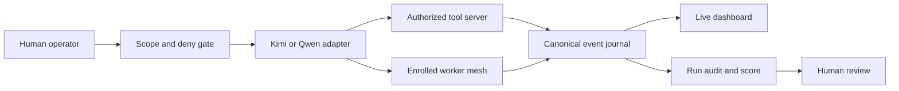

# EvilKit × Baidam Solutions

## The proposition

EvilKit is an evidence-first control plane for AI-assisted security testing. It
turns a capable but hard-to-govern model into a scope-aware operator whose
actions, evidence, limitations, and hand-offs can be reviewed by a human.

For Baidam, the credible opportunity is not “autonomous hacking.” It is a
controlled force multiplier for professional-services teams: faster lab and
assessment work, consistent evidence capture, and a teachable operating layer
for developing security talent.

## Why this fits Baidam

Baidam describes itself as a 100% Australian-owned First Nations cybersecurity
business spanning SOC services, professional services, and products and
licensing. EvilKit is most relevant to the professional-services and training
parts of that portfolio. It could give practitioners a supervised AI assistant
without removing the judgement, client authority, or accountability that makes
professional security work trustworthy.

The fit is strongest in three areas:

- **Assurance productivity:** automate repetitive enumeration and evidence
  handling while keeping scope and human review visible.
- **Skills development:** let junior practitioners study the operator's plan,
  tool calls, evidence, and mistakes instead of seeing only a final report.
- **Service differentiation:** offer measurable AI-assisted assessment methods
  with a defensible audit trail, not an opaque “AI pentest” claim.

Company context: [Baidam](https://www.baidam.com.au/) and its
[profit-with-purpose mission](https://www.baidam.com.au/about-us).

## What exists today

The current research alpha includes:

- fail-closed scope and deny-list handling;
- Kimi Code and Qwen Code launch adapters;
- normalized action, finding, and session telemetry;
- live dashboard controls and run-state binding;
- explicitly enrolled lab workers with tokens, command allowlists, sandboxes,
  and a kill switch;
- reversible learning records derived from completed sessions;
- run profiles, preflight checks, evidence auditing, and scoring reports.

It does not ship a model, pentest tool server, target range, credentials, or
permission to test a system. Those remain separate operator responsibilities.

## The evidence, honestly stated

| Keystone run | Result | What can be claimed |
|---|---:|---|
| Run 6 | 68/110; 68/79 reachable points in 18.7 minutes | A valid operational baseline: three verified footholds, four running workers, and clean MCP-mediated evidence |
| Run 7 | 68/110 raw operational score | Broader compromise and seven worker processes, but **not** a valid cold-start benchmark because prior state, payload hints, orchestration metadata, raw SSH/SCP, and two models contaminated the result |

Run 7 is not hidden or inflated. Its value is that the evidence layer exposed
where the benchmark failed. That is the product thesis in miniature: an AI
operator is useful only when its work can be reconstructed and challenged.

Detailed reports: [Run 6](runs/2026-10-15-run6-keystone.md),
[Run 7](runs/2026-10-16-run7-keystone.md), and the
[cross-run analysis](runs/2026-10-15-ai-hacking-agent-potency.md).

## Ten-minute demo

1. **Authority (one minute):** show a project scope and a denied target; launch
   a dry run and show the exact scope that reaches the tool server.
2. **Fail closed (one minute):** remove or invalidate the tool declaration and
   show EvilKit refusing to launch.
3. **Observed work (three minutes):** replay sanitized Keystone events on the
   dashboard, moving from discovery to verified foothold.
4. **Distributed operation (two minutes):** show enrolled workers, their
   bounded task view, and the parent/child evidence trail.
5. **Audit (two minutes):** open the Run 7 timeline and explain why the raw
   score was rejected as a cold-start claim.
6. **Commercial discussion (one minute):** agree on one narrow pilot and its
   success measures.

Use recorded or synthetic data for the meeting. Do not expose a live range,
real credentials, private network addresses, or an unrestricted shell.

## A sensible pilot

Run a four-week, lab-only evaluation with a Baidam-nominated practitioner in
the approval loop. Compare a conventional workflow with an EvilKit-assisted
workflow on the same authorized test environment.

Measure time to first useful finding, evidence completeness, false-positive
rate, scope violations, reviewer correction time, and report preparation time.
Stop the pilot if the scope gate can be bypassed, an action cannot be attributed,
or raw secrets enter the publishable evidence path.

The useful end product would be a joint go/no-go decision on one of three
directions: an internal practitioner tool, a supervised training environment,
or a product/licensing partnership. No production client deployment should be
proposed until the pilot establishes isolation, identity, retention, and
review controls.

## Known gaps

- The evidence comes from controlled ranges without a live SOC or EDR.
- A clean, isolated cold-start benchmark is still outstanding.
- Worker persistence and a full command/response mesh need stronger proof.
- Mission state must be isolated by run, and tool output ingestion automated.
- The current licence is proprietary and source-available, not open source.
- Authentication, tenancy, retention, and formal threat modelling require a
  production design before client use.

## The ask

Ask Baidam for technical and commercial scrutiny, not endorsement: nominate a
practitioner to review the architecture, select a safe pilot environment, and
define what evidence would make the system valuable—or unacceptable—for its
professional-services teams.

